# MERIDIAN Design System (`v1.3.0`)

**Sistema Visual, Editorial, Navegacional, de Motion, Blueprints SVG (Plotter) e Arte Generativa 100% TypeScript** criado para o ecossistema **Lunar + Earth AI + Gemini Studio** (React Native + Web · CSS Puro · SVG 1:1).



---

## Linhagem & Pilares

- **Anthropic Research & Economic Scenarios:** superfícies quentes (*Ivory* `#FAF9F5`), dual-radius (*pills* + *squircles*), masonry editorial assimétrico, paleta orgânica contida (*Olive, Sky, Coral, Ochre, Slate*) e blocos preenchidos em aquarela.
- **Deimos Archival (White / Aqua / Terracotta / Dark):** motor **Single-Ink** via `color-mix()`, textura global de papel algodão (`PaperGrain` 512×512 em `multiply` / `screen + invert(1)`), leitor enciclopédico em 3 colunas com citações clicáveis (`Tier A–C`), *Lifeline* arrastável e estante 3D de dossiês.
- **Emil Kowalski (`emilkowalski/skills`):** *Frequency Gate* (`0ms` em `⌘K` e atalhos), curvas `--ds-ease-out` / `--ds-ease-in-out` / `--ds-ease-drawer`, *Clip-Path Seamless Tabs*, *Hold-to-Confirm* assimétrico, popovers *origin-aware*, tooltips *skip-delay*, *Sonner toasts* interruptíveis, *Vaul drawer*, física 1:1 de drag + momentum e baseline *mobile-native* + Reanimated 4.
- **Plotter (`pasqualevitiello/plotter`) + Globo 81k (`anthropic.com/features/81k-interviews`):** gramática SVG editável em 1 tinta (`currentColor`), traço único (`1u`), 13 papéis semânticos (`data-plotter-role`), isolamento didático e globo ortográfico pontilhado em TypeScript puro.
- **Atelier Generativo 100% TypeScript (Zero `p5.js`):** motor criativo portável (Canvas 2D / `@shopify/react-native-skia`) com **Aquarelas**, **Lápis Grafite (`2H`/`HB`/`4B`)**, **Giz de Cera** e **Pincel Sumi-e** rodando abaixo de `0.7ms/frame`.

---

## As 5 Atmosferas "Single-Ink"

| Superfície (`data-surface`) | Ground (`--ds-bg`) | Ink (`--ds-fg`) | Contraste | Uso Ideal |
| :--- | :---: | :---: | :---: | :--- |
| **`ivory`** *(Padrão)* | `#FAF9F5` | `#141413` | `17.6:1` (AAA) | Home editorial, apps B2C cotidianos, leitura calma |
| **`paper`** | `#FFFFFF` | `#0A0A0A` | `19.8:1` (AAA) | Dossiês PDF, Raio-X do Endereço, relatórios B2B |
| **`aqua`** | `#A4CED0` | `#171614` | `10.4:1` (AAA) | Earth AI, Clima, Qualidade do Ar, AgroCiclos |
| **`terracotta`** | `#EDBB99` | `#171614` | `10.4:1` (AAA) | Cultura Pop, Social/Voz, Solar 3D, narrativas |
| **`obsidian`** | `#0E0E0D` | `#FAF9F5` | `18.4:1` (AAA) | Terminal Gann–Jenkins, Efemérides, modo noturno Pro |

---

## Estrutura do Repositório

```text
Meridian/
├── README.md                  # Visão geral e guia rápido
├── DESIGN_SYSTEM.md           # Especificação completa v1.3.0
├── index.html                 # Vitrine interativa autônoma (pronta p/ GitHub Pages, 100% offline)
├── package.json               # Manifesto ESM + exports tipados (zero dependências)
├── tsconfig.json              # TypeScript strict mode
├── src/
│   ├── index.ts               # Barrel export completo
│   ├── tokens.css             # 5 atmosferas Single-Ink, PaperGrain, Motion, Mobile-Native e Plotter CSS
│   ├── components.css         # Biblioteca CSS pura de componentes editoriais e interativos
│   ├── tokens.ts              # Tokens tipados p/ React Native, Web, Reanimated 4, Haptics e SVG 1:1
│   ├── paper-grain.ts         # Gerador procedural Canvas 512×512 de papel algodão
│   ├── plotter-svg.ts         # Gramática Plotter (13 papéis) + Globo Ortográfico 81k editável
│   └── atelier-engine.ts      # Motor estilo p5.js/p5.brush 100% TS (Aquarela, Lápis, Giz, Pincel)
└── assets/
    └── meridian-globe-81k.svg # Exportação SVG editável do globo (padrão Plotter)
```

---

## Uso Rápido

### 1. Preview Interativo Local (Zero Build)
Abra [`index.html`](./index.html) diretamente no navegador — ou ative o **GitHub Pages** na branch `main` (root `/`) para publicar a vitrine ao vivo.

- Teclas **`1`–`5`**: alterna entre as 5 atmosferas em tempo real
- Tecla **`M`**: alterna **B2C Invisível** ↔ **Técnico Pro**
- **`⌘K` / `/`**: abre a paleta de navegação instantânea (`0ms`)

### 2. CSS Puro (Web)
```html
<link rel="stylesheet" href="./src/tokens.css" />
<link rel="stylesheet" href="./src/components.css" />
<html data-surface="ivory" data-mode="invisible" data-grain="editorial">
```

### 3. TypeScript (React Native / Web / Atelier / Plotter)
```ts
import {
  getSurfaceTheme,
  MOTION,
  mountPaperGrain,
  renderPlottedGlobeSvg,
  runMeridianSketch,
  createEconWatercolorSketch,
} from './src/index.ts';

// 1. Tema Single-Ink pré-resolvido para React Native / Web
const theme = getSurfaceTheme('aqua');

// 2. Textura de papel algodão 512×512 (Web)
mountPaperGrain();

// 3. Globo Ortográfico 81k em SVG editável padrão Plotter
const globeSvg = renderPlottedGlobeSvg({ rotLonDeg: -46, tiltLatDeg: 15 });

// 4. Animação generativa de aquarela + lápis (100% TS, zero p5.js)
runMeridianSketch(canvasEl, createEconWatercolorSketch(), {
  surface: 'ivory',
  maxFrames: 92,
  respectReducedMotion: true,
});
```

---

## Documentação Completa
Leia a especificação detalhada em [`DESIGN_SYSTEM.md`](./DESIGN_SYSTEM.md).
